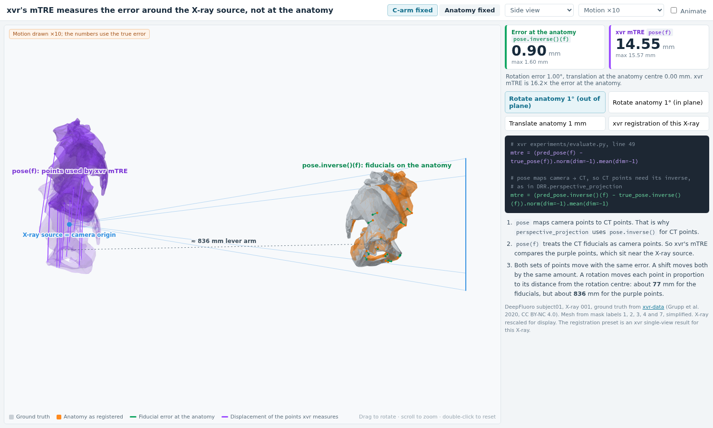

# xvr mTRE: where is the error measured?

Hi Vivek, I made this small demo to go with my issue about the mTRE in xvr.

I believe the mTRE in [`experiments/evaluate.py`, line 49](https://github.com/eigenvivek/xvr/blob/caa55cc8096294cf70a218126bf16008dee0dec7/experiments/evaluate.py#L49) applies the pose in the wrong direction. `pose` maps camera points to CT points. Applying it to the CT fiducials treats them as camera points, so the compared points (purple) end up near the X-ray source instead of on the anatomy (green). This makes rotation errors much larger.

To run the demo, open `index.html` in a browser.



The numbers below use DeepFluoro subject01, X-ray 001:

| Error | Fiducials, `pose.inverse()(f)` | Current mTRE, `pose(f)` |
|---|---:|---:|
| Rotate the pelvis 1° (out of plane) | 0.90 mm | 14.55 mm |
| Rotate the pelvis 1° (in plane) | 1.20 mm | 1.30 mm |
| Move the pelvis 1 mm | 1.00 mm | 1.00 mm |
| An xvr registration of this X-ray | 0.49 mm | 2.90 mm |

Using the inverse, like `perspective_projection` does, measures the error at the fiducials:

```diff
-        mtre = (pred_pose(self.fiducials) - true_pose(self.fiducials)).norm(dim=-1).mean(dim=-1)
+        mtre = (pred_pose.inverse()(self.fiducials) - true_pose.inverse()(self.fiducials)).norm(dim=-1).mean(dim=-1)
```

Of course, if I've misunderstood something, please let me know.

Thanks a lot for DiffDRR, DiffPose and xvr. I've learned a lot from them.

Jianfeng

---

Data: DeepFluoro (Grupp et al. 2020, CC BY-NC 4.0) from [xvr-data](https://huggingface.co/datasets/eigenvivek/xvr-data). The mesh comes from mask labels 1, 2, 3, 4 and 7, simplified. `tools/prepare_data.py` rebuilds `data/` from xvr-data. Code: MIT. Files in `data/`: CC BY-NC 4.0.
